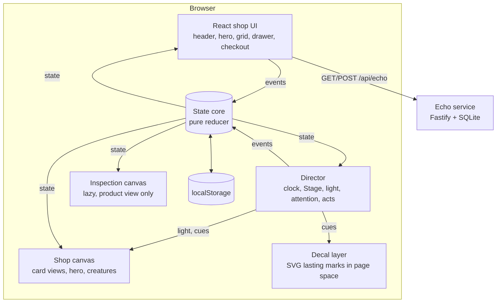
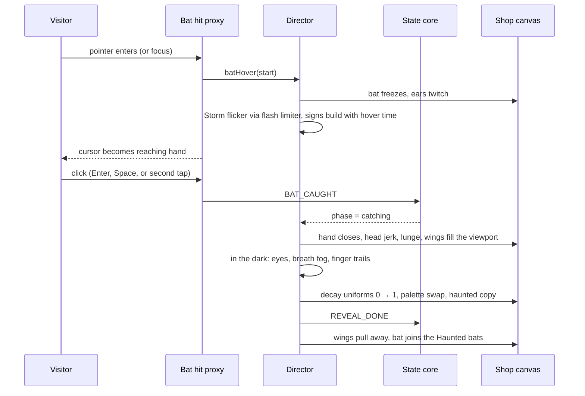

# Design Document

## Overview

Re:Claim is a single-page web app (the Shop) plus a tiny Echo service. The Shop is a normal, accessible React storefront. On top of it sit three systems that make it haunted:

1. **Live objects:** every product is a real-time 3D object rendered through one shared WebGL canvas, with a decay shader that burns, tears, rots and dusts the same object in place.
2. **The Director:** one scheduler that owns time, the Stage (one major Anomaly at a time), light and power, attention ("watched" or not) and pacing by act.
3. **The State core:** a pure, serializable reducer that holds the whole story state (phase, act, Weight, cart, lasting marks). Everything else reads from it. It is what the property-based tests target.

Design goals, in priority order: the story beats always work (on every device, with keyboard, with reduced motion); the day shop is a believable store; the haunted shop is unforgettable; performance stays smooth; the code stays small enough to finish by Dec 4.

## Technology choices

| Concern | Choice | Why |
| --- | --- | --- |
| Build and dev server | Vite + TypeScript (strict) | Fast, small output, code splitting for the 3D chunks |
| UI | React 19 | Mature, works with React Three Fiber |
| Routing | React Router (declarative mode) | Product view as a modal route over the shop, so browser Back closes it |
| 3D | three.js + React Three Fiber + drei | `View` lets one canvas draw many card views; `useGLTF`, `ContactShadows`, `Environment` helpers |
| Post-processing | `postprocessing` (inspection canvas only) | AO, bloom, depth of field where it matters, without slowing the grid |
| Animation | GSAP (timelines) + CSS | Precise multi-step sequences (catch and lunge, closing time), free for this use |
| State | Pure reducer + a tiny subscription store (Zustand) | Testable core, selective re-renders |
| Echo service | Node + Fastify + SQLite (`better-sqlite3`) | Tiny, one file database, easy in Docker |
| Tests | Vitest, fast-check, Playwright | Unit, property-based and end-to-end, with Playwright's clock control |
| Serving | nginx in Docker, Compose for both services | `docker compose up` gives the full site on port 8080 |

Exact versions are pinned in `package.json` at setup, using the latest stable releases on that day.

## Architecture



### Repository layout

```
/                      repo root (the reclaim project)
├─ web/                the Shop (Vite app)
│  ├─ src/core/        state core: types, reducer, selectors, persistence
│  ├─ src/director/    clock, Stage, light, attention, acts, anomaly registry
│  ├─ src/shop/        React UI: layout, header, hero, grid, product view, cart, checkout
│  ├─ src/gl/          shared canvas, views, decay material, lighting, creatures
│  ├─ src/products/    one folder per product: data, model, quirks, inspection, consequence
│  ├─ src/fx/          DOM and SVG effects: decals, footprints, hand cursor, darkness overlay
│  ├─ public/models/   self-hosted compressed glTF (CC0 only, listed in ASSETS.md)
│  └─ tests/           unit and property tests
├─ api/                Echo service
├─ e2e/                Playwright tests
├─ docker-compose.yml
└─ ASSETS.md           every third-party asset with source and license
```

## Rendering layers

The page is a stack of layers. Order matters because darkness must cover the UI but not the flames and eyes, and the product view must blur everything behind it.

| z | Layer | Content | Pointer events |
| --- | --- | --- | --- |
| 0 | Shop DOM | header, hero frame, tiles, grid cards (text, prices, buttons), footer | yes |
| 1 | Decal layer | SVG in document space: footprints, blood prints, drag marks, ash, scorch, wax, stuffing. Scrolls with the page. | no |
| 2 | Darkness overlay | one fixed `div`, black with opacity `1 - mains`, capped at 0.5 during Brownouts | no |
| 3 | Shop canvas | fixed full-viewport WebGL: each card's object (a drei `View` tracking an empty box in the card's image area), the hero scene, bats, the crawling hand, eyes, dust sheets, the lunge | no |
| 4 | Hit proxies | invisible DOM buttons positioned over interactive 3D things (the Day bat, the snow globe, the mitten) so they get focus, ARIA names and clicks | yes |
| 5 | Overlay DOM | product view, cart drawer, checkout, receipt; `backdrop-filter` dims and blurs layers 0–3 behind it | yes |
| 6 | Inspection canvas | second WebGL context, created only while the product view is open, with full post-processing | yes |
| 7 | Cursor layer | the hand cursor (SVG), shown only over the Day bat's proxy | no |

Because the shop canvas sits above the DOM, objects are drawn only inside each card's image box; the card's text and buttons sit outside it, so 3D never covers controls. Flames, eyes and the cart glow are emissive in the canvas, so they stay bright above the darkness overlay.

**Two WebGL contexts at most:** the shop canvas, plus the inspection canvas while a product is open. This replaces Requirement 27.2's single-context wording (updated in requirements). During inspection the shop canvas drops to a low frame rate and only draws the "behind the product view" events.

## State core

All story state lives in one serializable object, changed only by a pure reducer `reduce(state, event) → state`. No timers, DOM or randomness inside it; the Director supplies time and random seeds through events. That makes it deterministic and easy to test with fast-check.

```ts
type Phase = 'day' | 'catching' | 'haunted' | 'closing' | 'checkout' | 'accepted' | 'returning';
type Act = 0 | 1 | 2 | 3 | 4;

interface StoryState {
  version: 1;
  phase: Phase;
  act: Act;
  weight: number;                     // distinct products carted in the Haunted state
  cart: Record<ProductId, number>;    // quantities, unchanged by the Reveal
  carted: ProductId[];                // carting order, used for the Echo
  played: Partial<Record<ProductId, true>>;   // consequences already played in full
  marks: LastingMark[];               // footprints, prints, ash, tilted tag… in page coordinates
  clock: { direction: 1 | -1 };
  extras: ProductId[];                // items that appeared (sneak into basket, haunted search)
  echo: EchoRef | null;               // object this visitor's shop shows in the hero
  settings: { motion: 'system' | 'reduced' | 'full'; sound: boolean };
}
```

Key events: `BAT_CAUGHT`, `REVEAL_DONE`, `ADD_TO_CART`, `SET_QTY`, `REMOVE`, `OPEN_CHECKOUT`, `CLOSING_DONE`, `ACCEPT`, `DECLINE`, `RETURN_DONE`, `MARK_ADDED`, `EXTRA_APPEARED`, `ECHO_LOADED`, `SETTINGS`.

Rules the reducer enforces (and the tests check):

- Only `BAT_CAUGHT` moves `day → catching`; only `REVEAL_DONE` moves `catching → haunted`.
- The Reveal never changes `cart`.
- `weight` only grows until `RETURN_DONE`; `act` is derived from `weight` and phase and never decreases.
- `ADD_TO_CART` in the Haunted state returns the Consequence to play (as a cue in the result), and marks it `played` so it plays in full only once.
- `ACCEPT` is ignored unless the in-story agreement flag is set.
- `RETURN_DONE` resets everything to the opening state except `echo` and `settings`.

**Persistence:** the state is saved to `localStorage` under `reclaim:v1` after each event, debounced. On load, an unknown or corrupt version starts fresh.

## The Director

The Director owns everything that happens over time. It runs on one `requestAnimationFrame` loop with a scalable clock (normal speed, or faster in `?director` mode and in tests), and pauses while the tab is hidden.

### Stage

Every unnatural event is an **Anomaly** registered with the Director:

```ts
interface Anomaly {
  id: string;
  size: 'major' | 'minor' | 'quirk';
  eligible(s: StoryState, env: Env): boolean;   // act, phase, darkness, attention, cooldowns
  weight(s: StoryState): number;                // how likely, grows with act
  play(ctx: CueContext): Promise<void>;         // GSAP timeline or shader tween
  reduced?(ctx: CueContext): Promise<void>;     // reduced-motion version
}
```

- A **major** Anomaly takes the Stage. While it plays, every other Anomaly holds still (bats freeze mid-perch, the hand stops, quirks pause).
- After a major Anomaly ends, the Stage stays empty for a quiet gap of at least 6 seconds (shorter as the act rises, never under 4).
- **Visitor-triggered** Consequences jump the queue: they pause whatever ambient Anomaly is playing and take the Stage at once.
- **Quirks** may run without the Stage, but only one quirk may be moving inside the viewport at a time.

### Attention

The Director keeps a small attention model (Requirement 36): the pointer position with a 250 px radius, which product boxes are in the viewport (IntersectionObserver), tab visibility and window focus, and time since the last input. Anomalies that "move when unwatched" check `env.isWatched(box)` every frame and stop the moment it turns true.

### Acts

`act` comes from the state. The Director reads it to scale three dials: how often ambient Anomalies are picked, how often Brownouts happen, and how far quirks go.

### Light and power

One value `mains` (0 to 1) drives every electric light. Each flame has its own value.

- **DOM:** `mains` sets a CSS custom property on the root. The darkness overlay, the bulb glows, the button sheen and the gold highlights all read it.
- **WebGL:** `mains` scales the key light and the environment intensity; flames and eyes are emissive and ignore it.
- **Brownout:** a tween to 0.3–0.7 with low-amplitude noise, a hold, and an uneven recovery.
- **Blackout:** `mains` goes to 0 for up to 3 seconds, then comes back in two or three steps.
- **Storm flicker (Day state hover):** a short pattern of dips.

All light changes go through one **flash limiter**. It counts transitions where brightness changes by more than 20% and refuses any pattern that would produce more than three flashes in a one-second window. The limiter is a pure function, so property-based tests cover it.

## Live objects

### Product modules

Each product is one folder in `src/products/<id>/` with the same shape:

```ts
interface ProductModule {
  meta: ProductMeta;                       // names, copy and prices for both states, category, rating
  Model: React.FC<{ decay: DecayParams; pose: PoseParams }>;   // the live object
  Inspection?: React.LazyExoticComponent<React.FC>;            // haunted inspection, loaded on demand
  quirks: Anomaly[];                       // idle weirdness (Requirement 35)
  consequence?: (ctx: CueContext) => Promise<void>;            // on Add to Cart in the Haunted state
}
```

The catalog is just the list of modules. Search, filters and sort run on `meta` only, so they never touch 3D.

### Decay material

All objects use `MeshPhysicalMaterial` extended through `onBeforeCompile` with one shared decay chunk. Its uniforms animate from 0 to 1 during the Reveal, so the same object changes in place:

| Uniform | Effect |
| --- | --- |
| `uBurn` | noise-driven charring that darkens albedo, raises roughness, with a thin glowing ember edge while it spreads |
| `uTear` | alpha-discard holes along a noise field, with frayed edges (fabric, paper, leather) |
| `uRot` | color drift to grey-green and brown, slight vertex sag on soft objects (cake, cream) |
| `uDust` | grey dusting on surfaces that face up, using the world normal |
| `uAge` | lower sheen and clearcoat, tarnish on metal, yellowing on paper |

Each product chooses which uniforms it uses, and how far they go, in its `meta`.

### Geometry sources

| Approach | Products |
| --- | --- |
| Procedural in code (lathe, extrude, tube, instancing) | pocket watch, mirror, photo frame, letter and envelope, cake, ornaments, gift box, chocolates, candle, snow globe, music box, telephone, advent calendar, valve radio, tin soldier |
| CC0 glTF models (self-hosted, compressed, listed in `ASSETS.md`), with our decay material | shoes, doll, teddy bear, typewriter, instant camera, mittens |

If a model needs moving parts (typewriter keys, telephone handset, camera iris), it is split into named nodes that the code animates. A model that fails the quality gate falls back to a still render of our own 3D scene, as Requirement 31.5 allows.

### Lighting and look

- The environment is generated in code (`RoomEnvironment` through PMREM); nothing is fetched from a CDN.
- Each card view has a warm key light, a soft rim light and contact shadows on a velvet backdrop. The velvet is a plane with a sheen material.
- In the Haunted state the key light turns cold and low, and the light comes from the room's own candles and lamps (no flashlight cursor).
- The shop canvas has no post-processing, to keep the grid fast. Film grain and vignette are a cheap CSS overlay. The inspection canvas gets ambient occlusion, bloom and depth of field.

### Quality gate

The pocket watch is built first, end to end (procedural model, decay, inspection, consequence). Tanvir judges it against the mockup's richness. Only after he approves does the same pipeline go to the other products.

### Performance plan

- `frameloop="demand"`: a view redraws only when its object animates, the light changes, or it scrolls.
- Views outside the viewport are skipped (IntersectionObserver).
- Device pixel ratio is capped at 1.5 on the shop canvas and lowered automatically if frames go above 22 ms.
- Models use meshopt compression and KTX2 textures. Budget: ≤ 600 KB per model and ≤ 6 MB of 3D assets in total, loaded lazily per visible card.
- If WebGL2 is missing, or the first-second frame time stays above 40 ms, the shop switches to still renders produced at build time by a Playwright script that photographs each product's view in both states. Since they come from our own 3D scenes, they need no extra license.

## Key sequences

### Day bat, hover, catch and Reveal



- The bat is a rigged 3D model in the shop canvas. Its DOM hit proxy follows its projected screen position every frame, so it works with keyboard, screen readers and touch.
- The palette swap is one CSS class on the root (`data-state="haunted"`) switching token values. Product copy comes from `meta.haunted`. Nothing in the DOM is moved, so positions, scroll and focus stay put.
- In reduced motion: the hand closes, the screen fades to black, then fades into the Haunted shop.

### Add to Cart in the Haunted state

1. The UI dispatches `ADD_TO_CART`. The reducer updates the cart and Weight and returns a `consequence` cue if the product has not played in full yet.
2. The Director pauses ambient Anomalies and gives the cue the Stage.
3. The product's `consequence(ctx)` runs. It gets helpers: the card's screen rectangle, the cart icon's rectangle, the decal layer, the shop canvas creature layer, the clock and the light controls.
4. Its Lasting mark is dispatched as `MARK_ADDED` (page coordinates), so it survives reloads.
5. The Stage is released and the quiet gap starts.

Example, the shoes: a path is generated from the card to the cart icon as a smoothed random walk that turns left and right. Prints are placed along it at stride length, alternating left and right, rotated to the path's direction. Each print fades in, holds, and fades over 10 seconds. The last pair is saved as a mark.

### Closing time, checkout and the ending

- **Closing time** is one GSAP master timeline with labelled beats (power fails, the eyes, the dust sheets, they turn, the sheet ghost, after). Escape or the Skip button jumps to the `after` label so the end state is always consistent. The dust sheets are a vertex-shader cloth: a subdivided plane draped over each card's object with noise-driven breathing, rather than a physics simulation.
- **Checkout** is a routed view with three steps: order summary, payment (time, age, or a preset memory), and agreement (an unchecked box plus an Accept button that stays disabled until the box is checked). Decline and Back always work.
- **Accept:** a short GSAP tremor on the root, every Anomaly is cancelled and the light holds still, then "Your order has been accepted." After about 4 seconds the core receives `RETURN_DONE`. The Shop re-renders the opening state with the Echo placed in the hero, and the Day bat perches on it.

## Echo service

| Endpoint | Behavior |
| --- | --- |
| `GET /api/echo` | returns up to five of the newest echoes: `{ id, product, condition }`. The client picks the newest one whose id it did not write itself (it remembers its own id locally). |
| `POST /api/echo` | body `{ product, condition }`. Both are checked against fixed allowlists generated from the catalog. Returns `{ id }`. |

- The SQLite table `echoes(id, product, condition, created_at)` keeps the newest 1000 rows. No IP, user agent, cookie or identifier is stored.
- Rate limiting keeps a short-lived in-memory counter keyed by a salted hash of the client IP, held in memory for 60 seconds and never written to disk or logs. Over 5 writes per minute gets HTTP 429.
- Request bodies over 1 KB are rejected. CORS allows only the Shop's origin. Fastify's JSON schema validation rejects anything malformed.
- The client gives up after 1.5 seconds and uses its local echo, or none.

## Accessibility

- All shopping controls are native buttons, links and inputs. Modals and drawers trap focus and restore it on close.
- Every interactive 3D thing has a DOM hit proxy with an ARIA name that does not spoil the story.
- One `aria-live="polite"` region announces cart changes and the order result. The Reveal is announced only as "The lights have changed."
- The motion setting (`system`, `reduced`, `full`) is read by the Director. Each Anomaly provides its reduced version.
- Both palettes are checked with an automated contrast test on the design tokens.

## Testing strategy

**Property-based tests (fast-check), on the pure parts:**

| Property | Requirement |
| --- | --- |
| For any event sequence, the cart before and after the Reveal is identical | 6.4, 10.2 |
| For any event sequence without `BAT_CAUGHT`, the phase never leaves `day` | 8.6 |
| The cart total always equals the sum of unit price × quantity | 6.5 |
| `weight` and `act` never decrease until `RETURN_DONE` | 37.4 |
| A product's consequence is cued in full at most once per run | 12.4 |
| `ACCEPT` without agreement never moves to `accepted` | 22.4 |
| After `RETURN_DONE`, the state equals the opening state except `echo` and `settings` | 23.1 |
| For any requested light pattern, the flash limiter's output has at most 3 flashes in any 1-second window | 9.4, 26.5, 34 |
| The Stage scheduler never runs two major Anomalies at once and always leaves the quiet gap | 12.3a, 12.3b |
| The footprint path always ends inside the cart icon's rectangle and alternates feet | 13.3 |
| Persisted state always round-trips through save and load | 6.3, 10.5 |
| The Echo API rejects anything outside the allowlists | 24.4, 24.5 |

**Unit tests (Vitest):** search, filter and sort; copy selection per state; the typewriter confession text (tomorrow's date, the last line); clock direction.

**End-to-end tests (Playwright, desktop and a 390 px phone, with and without reduced motion):** the normal shopping flow; the Day bat (perching, hand cursor on hover, signs, catch, lunge, keyboard catch, two-tap catch); the Reveal keeping cart, scroll and focus; each Featured product's consequence and its Lasting mark after reload; closing time including Skip; checkout agreement and decline; the ending and the Echo with the API up and down. Time is controlled with Playwright's clock and the Director's time scale.

**Visual checks:** a Playwright screenshot of each product in both states, reviewed by eye at each milestone.

## Delivery

- `docker compose up` builds two images. `web` runs nginx on port 8080, serving the built Shop and proxying `/api` to `api`. `api` runs Fastify on port 3000 with a named volume for SQLite.
- Without Docker: `npm install` and `npm run dev` in `web/` and `api/`.
- **Public hosting for judges** (must stay up until Jan 29, 2027): decided before submission. Candidates are a small VPS running the same Compose file, or a static host for `web` plus a small always-on container for `api`.

## Kiro usage plan

Only what actually happens gets recorded in `docs/KIRO_USAGE.md`.

- **Specs:** this requirements → design → tasks flow, executed task by task.
- **Steering:** `hackathon-rules.md` and `design-direction.md` (both exist); a `code-conventions.md` steering file added at setup.
- **Hooks:** candidates are running related unit and property tests when `src/core` or `src/director` files are saved; checking that every new file under `public/models` has an `ASSETS.md` entry; a reminder to log Kiro usage after each finished task.
- **MCP:** candidate is a Playwright or browser MCP server so the agent can look at the running shop and check visual changes.

## Risks and mitigations

| Risk | Mitigation |
| --- | --- |
| Live objects not convincing enough | Quality gate on the pocket watch first; per-object fallback to our own renders (Req 31.5) |
| Too much scope for 19 days | Build order from `docs/CREATIVE_DIRECTION.md` section 7; Tier B and sound only if time allows |
| Slow on phones | Demand rendering, view culling, DPR cap, automatic fallback to still renders |
| Judges miss the bat | It shows within 10 seconds, moves every 15–40 seconds, and follows the visitor down the page; the video shows the catch |
| Flashing harms photosensitive visitors | A single flash limiter for all light changes, covered by property tests |
| CC0 model licenses unclear | Use only sources that state CC0 on the asset page, and record the URL in `ASSETS.md` |
| The public demo goes down before judging ends | Always-on hosting, an uptime check, and a local fallback for the Echo |