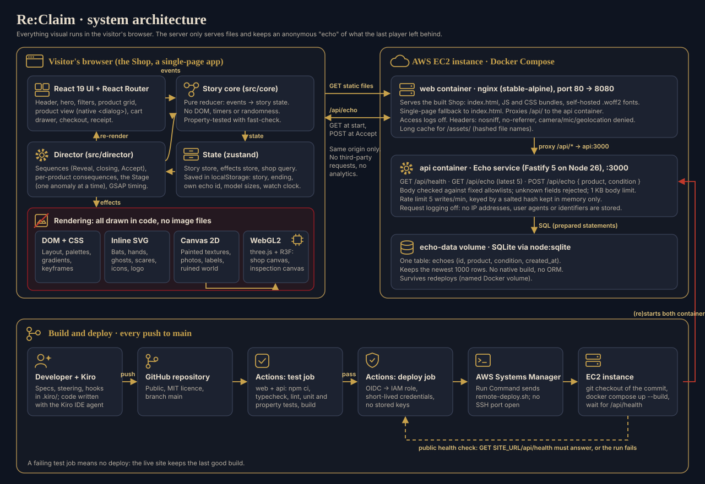

# Re:Claim

> *A Christmas shop that sells what the war left behind.*
> Kiroween 2026 submission, **Costume Contest** category.

Re:Claim opens as a cheerful Christmas shop, Reclaim & Co. Holiday Market. A small bat has got in. Catch it, and the same shop is revealed after a fictional war: every object belonged to someone, and every object answers back when you take it. At the end, a receipt shows the dark patterns the shop used on you, the same ones real shops use every holiday season.

**Content note:** fictional war, blood, mild psychological horror, brief darkness effects. Nothing flashes more than three times per second. Reduced motion is supported.

## Links

- Live app: _TBD_
- Demo video (YouTube): _TBD_
- Devpost: _TBD_

## Documentation

| Document | What it covers |
| --- | --- |
| [docs/ARCHITECTURE.md](docs/ARCHITECTURE.md) | System architecture, visitor workflow and rendering diagrams |
| [docs/TECH_STACK.md](docs/TECH_STACK.md) | Every technology and version, and how the frontend draws everything without image files |
| [docs/SUBMISSION.md](docs/SUBMISSION.md) | Devpost text, testing instructions for judges, submission checklist |
| [docs/KIRO_USAGE.md](docs/KIRO_USAGE.md) | How Kiro was used: specs, steering, hooks, property tests, agents |
| [docs/KIROWEEN_RULES.md](docs/KIROWEEN_RULES.md) | Hackathon rules summary |
| [docs/CREATIVE_DIRECTION.md](docs/CREATIVE_DIRECTION.md) | Story and visual direction |
| [deploy/README.md](deploy/README.md) | AWS and GitHub setup for the automatic deploy |
| [ASSETS.md](ASSETS.md) | Third-party assets (fonts) and their licences |



## What it does

- **The Christmas shop:** search, categories, price filter, sort, grid and list view (all kept in the URL), a product view with a turnable live object, a cart drawer and a checkout.
- **Live objects:** all 24 products are real-time 3D, built in code. When the shop turns, one shared decay shader burns, tears, rots, dusts and ages the same objects in place.
- **The bat:** it hangs from the decorations and flies between perches. Over it the cursor becomes a reaching hand and the lights flicker. Catch it (click, Enter, or two taps) and it jerks round, lunges and covers the screen with its wings, and the shop turns in the dark.
- **The haunted shop:** palette, copy, menu and logo change, but the layout does not. Bats fly in the dark with glowing eyes, and brownouts come and go. A severed hand crawls up. A scarecrow creaks in the hero, a werewolf howls on a far tower, and skeletons move in the graveyard under the shelves.
- **Takes and consequences:** adding a product to the cart in the haunted shop is a Take. The object answers back inside its own picture:
  - the shoes walk to the cart;
  - the watch and the shop clock run backward;
  - the doll's head snaps round to you;
  - the letter opens on a photo;
  - the typewriter types a confession;
  - a face rises in the mirror;
  - the phone's receiver lifts and bleeds;
  - the candle goes out and its smoke shows a face;
  - black hands press against the snow globe from inside;
  - the camera turns to you and prints;
  - and so on for every product.
- **Closing time, checkout and the ending:**
  - On the way to checkout, dust sheets fall, eyes open and a sheet ghost passes.
  - You pay with time, age or a memory.
  - After Accept comes one tremor and one found-footage jump scare. Then, on black, "Forgive me, Lord, for I have sinned." is written in blood.
  - The Christmas shop then returns with what you left behind, and a receipt lists the dark patterns it used.
- **Echo:** the next visitor finds what the previous player left. No identifiers are stored.

## Run it

### With Docker

```sh
docker compose up --build
```

Open http://localhost:8080. nginx serves the Shop, and `/api` goes to the Echo service. Defaults can be changed in a `.env` file (see [.env.example](.env.example)). No secrets are needed.

### Without Docker

You need Node.js 24 or newer (tested on 26).

```sh
cd api && npm install && npm run dev      # Echo service on :3000
cd web && npm install && npm run dev      # Shop on http://localhost:5173 (proxies /api)
```

The Shop also runs without the API. The Echo is simply empty then.

**Fallback:** without WebGL2, or with `?nogl` in the URL, the cards show the product name on velvet instead of a live object.

## Tests

```sh
cd web && npm run typecheck && npm run lint && npm test   # 62 unit and property tests
cd api && npm run typecheck && npm test                   # 7 API tests
cd e2e && npm install && npx playwright install chromium && npm test   # desktop, 390 px phone, reduced motion
```

## Deploy

Every push to `main` is tested by GitHub Actions. If the tests pass, it is deployed to AWS EC2 through GitHub OIDC and AWS Systems Manager. No keys are stored and no SSH port is open. Setup: [deploy/README.md](deploy/README.md).

## Project layout

| Path | What |
| --- | --- |
| `web/` | The Shop: Vite, React, TypeScript, three.js / React Three Fiber |
| `api/` | Echo service: Fastify with Node's built-in SQLite |
| `e2e/` | Playwright tests |
| `.kiro/` | Kiro specs, steering and hooks used to build this project |
| `docs/` | Architecture, tech stack, submission text, Kiro usage log, rules notes |
| `deploy/` | EC2 deploy script and IAM policies |

## Accessibility and privacy

- **Accessibility:**
  - Both palettes meet WCAG AA contrast, which a unit test checks.
  - Every control works from the keyboard, and every 3D object has a DOM control with an accessible name.
  - `prefers-reduced-motion` replaces motion with end states and fades.
  - There is no audio in this build.
- **Privacy:**
  - No analytics, trackers or third-party requests. The only network call is the same-origin Echo API.
  - nginx access logs and API request logs are off, so no IP addresses or user agents are stored.

## Third-party software, services and terms

**APIs and data:** the app calls no third-party API at runtime and uses no external dataset.

**Libraries:** all open source and used under their licences. Exact versions are in each `package.json`.

| Library | Licence |
| --- | --- |
| React, React DOM, React Router, zustand, three.js, React Three Fiber, drei, Fastify, `@fastify/rate-limit`, Vite, Vitest, fast-check, ESLint, Prettier | MIT |
| TypeScript, Playwright | Apache-2.0 |
| GSAP | GSAP Standard "no charge" licence (https://gsap.com/standard-license), free for this use |
| `postprocessing` (installed, not used in the current bundle) | zlib |

**Fonts:** Fraunces, Inter and Creepster, all SIL Open Font License 1.1, self-hosted from `@fontsource` packages. See [ASSETS.md](ASSETS.md).

**Services:**
- GitHub and GitHub Actions host the code and run CI, under the GitHub Terms of Service.
- AWS (EC2, Systems Manager, IAM) hosts the app, under the AWS Customer Agreement.
- Docker images `node:26-alpine` and `nginx:stable-alpine` are used under their licences.

**Images, models, sound:** none. Every object, texture, "photo" and effect is made in code. The reference pictures used during development are not in the repository. See [docs/TECH_STACK.md](docs/TECH_STACK.md#where-the-pictures-come-from-there-are-no-image-files).

## Pre-existing code

None. All code in this repository was written during the Kiroween 2026 Submission Period (from Oct 30, 2026). The project uses only the open-source libraries listed above, including the three.js examples modules `RoomEnvironment` and `BufferGeometryUtils` that ship with the `three` package. No starter template was used.

## Status

Still open, tracked in [.kiro/specs/reclaim/tasks.md](.kiro/specs/reclaim/tasks.md):

- the storage descent behind "Load more"
- Tier B products
- a measured performance pass
- opt-in sound
- an uptime check until Jan 29, 2027
- the demo video and the Devpost submission

## How Kiro was used

See [docs/KIRO_USAGE.md](docs/KIRO_USAGE.md). The spec is in [.kiro/specs/reclaim](.kiro/specs/reclaim), steering in [.kiro/steering](.kiro/steering) and hooks in [.kiro/hooks](.kiro/hooks).

## License

[MIT](LICENSE) © 2026 Tanvir Ahmed
