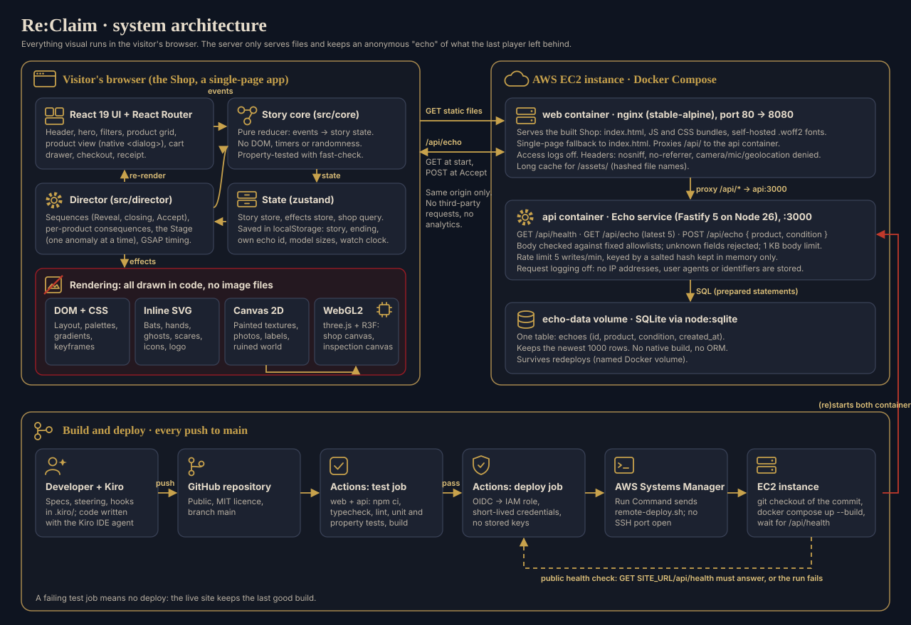
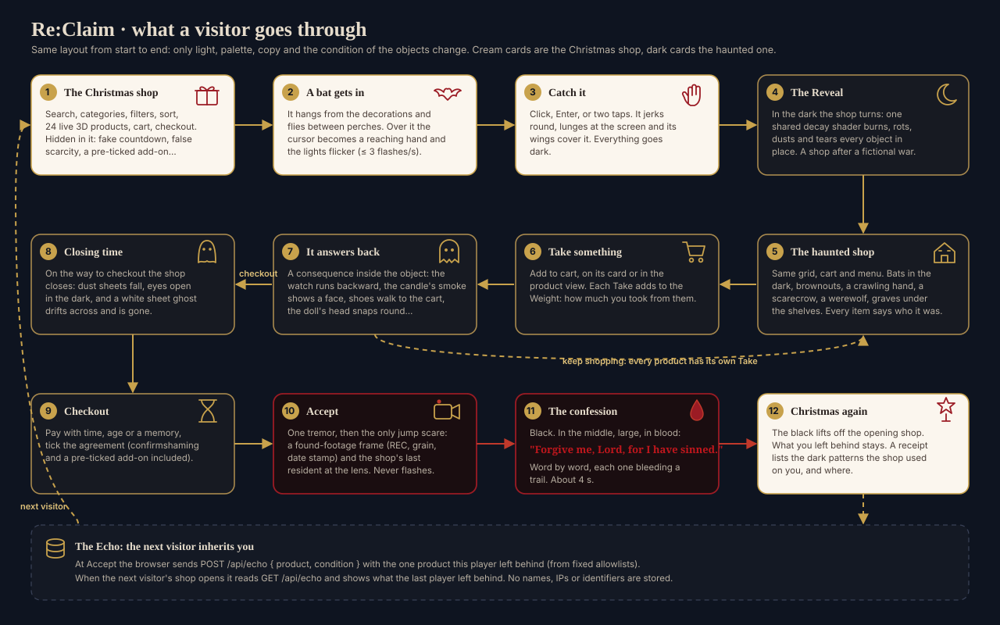
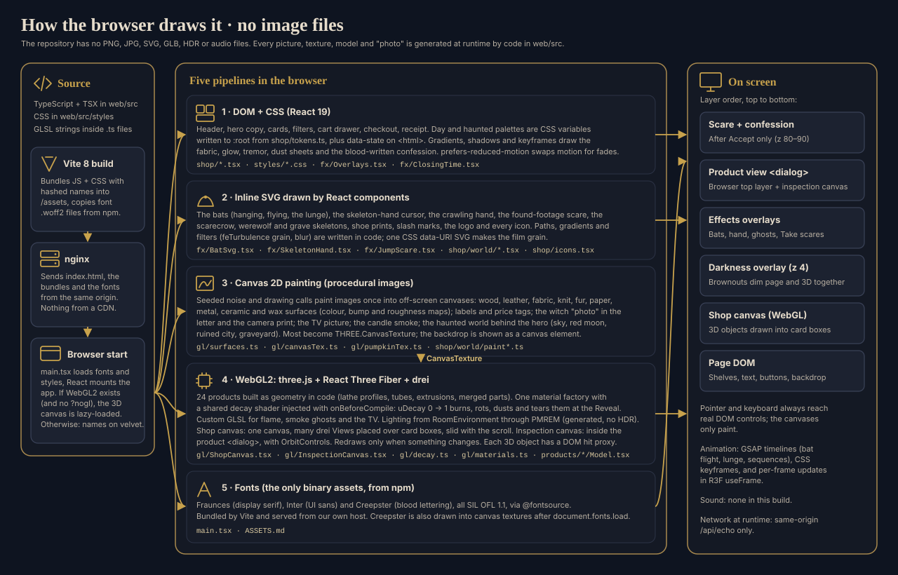

# Architecture and workflow

Re:Claim is a single-page web app plus a very small API. All of the story and all of the drawing happen in the visitor's browser. The server sends files and keeps an anonymous "echo" of what the last player left behind.

## System architecture

**In the browser**

- **React UI:** pages and controls. User actions become story events.
- **Story core (`web/src/core`):** a pure reducer that turns each event into the next story state. It is the part covered by property tests.
- **Director (`web/src/director`):** everything that takes time, such as the Reveal, closing time, the Accept sequence and each product's consequence. It reads the state, dispatches events and starts effects.
- **zustand stores:** hold the state and save it to `localStorage`. React re-renders from them.
- **Rendering:** four code-only layers draw everything: DOM + CSS, inline SVG, Canvas 2D textures and WebGL2. See [TECH_STACK.md](TECH_STACK.md).

**On the server (one EC2 instance, Docker Compose)**

- **nginx:** serves the built Shop and proxies `/api/` to the API container.
- **Echo service:** Fastify with fixed allowlists and a rate limit. It keeps no logs of visitors.
- **SQLite:** one table on a named volume, holding only `product`, `condition` and a timestamp.

**Delivery:** every push to `main` runs the tests. If they pass, GitHub Actions deploys through OIDC and AWS Systems Manager, then checks `/api/health`.

## Visitor workflow

1. **The Christmas shop:** a working store with search, filters, 24 live 3D products, a cart and a checkout. A few dark patterns are hidden in it.
2. **A bat gets in:** over the bat the cursor becomes a reaching hand.
3. **Catch it** with a click, Enter or two taps. It lunges, and its wings cover the screen.
4. **The Reveal:** in the dark, a shared decay shader ages every object in place.
5. **The haunted shop:** same layout, same cart, new light and copy.
6. **Take something:** adding an item to the cart is a Take.
7. **It answers back:** each Take plays a consequence inside that object.
8. **Closing time:** on the way to checkout, dust sheets fall and a sheet ghost passes.
9. **Checkout:** you pay with time, age or a memory.
10. **Accept:** one tremor, then the only jump scare.
11. **The confession:** "Forgive me, Lord, for I have sinned." is written in blood on black.
12. **Christmas again:** the opening shop returns. A receipt lists every dark pattern the shop used, with the place it used it.

At Accept, the browser posts the product this player left behind to the Echo service. The next visitor's shop reads it.

## Rendering pipeline

## Source layout

| Path | What lives there |
| --- | --- |
| `web/src/core` | Pure story reducer, types, persistence (no DOM, no timers) |
| `web/src/director` | Sequences, consequences, the Stage, Echo client |
| `web/src/shop` | Shop UI components, design tokens, the haunted world backdrop |
| `web/src/gl` | Shop canvas, inspection canvas, materials, decay shader, procedural textures, fitting |
| `web/src/products/<id>` | One folder per product: its 3D model and its Take event |
| `web/src/fx` | Overlays and effects (bats, hands, ghosts, scares, confession) |
| `web/src/styles` | CSS per area |
| `web/tests` | Unit and property tests (Vitest, fast-check) |
| `api/src` | Echo service (Fastify, `node:sqlite`) and its tests |
| `e2e/tests` | Playwright tests: desktop, a 390 px phone, reduced motion |
| `.kiro/` | Specs, steering and hooks used to build the project |
| `deploy/` | EC2 deploy script and IAM policies |

The full design, with requirement numbers, is in [.kiro/specs/reclaim/design.md](../.kiro/specs/reclaim/design.md).
