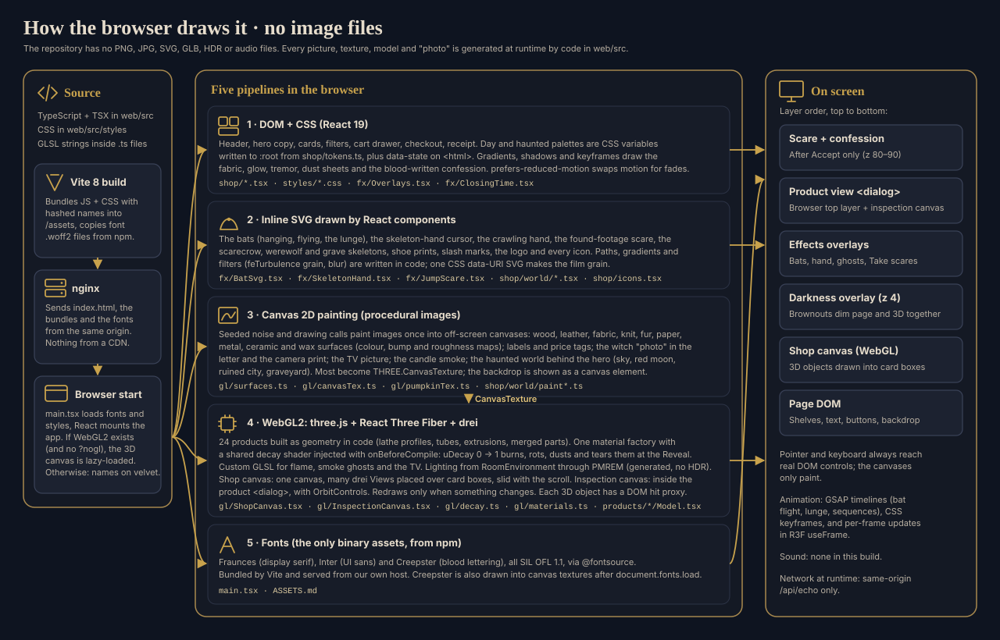

# Technology stack

This page lists exactly what Re:Claim uses, with the versions pinned in the repository, and explains how the frontend draws everything without image files.

## At a glance

| Layer | Technology | Version | Licence |
| --- | --- | --- | --- |
| Language | TypeScript (strict, `noUncheckedIndexedAccess`, `verbatimModuleSyntax`) | 6.0.3 | Apache-2.0 |
| Runtime | Node.js | 26 (24 or newer works) | MIT |
| Frontend build | Vite + `@vitejs/plugin-react` | 8.3.8 / 6.3.0 | MIT |
| UI | React + React DOM | 19.3.1 | MIT |
| Routing | React Router | 8.5.1 | MIT |
| State | zustand | 5.1.0 | MIT |
| 3D | three.js | 0.187.0 | MIT |
| 3D in React | `@react-three/fiber` (R3F) | 9.8.2 | MIT |
| 3D helpers | `@react-three/drei` (`View`, `PerspectiveCamera`, `OrbitControls`, `Decal`, `RoundedBox`) | 10.7.9 | MIT |
| Animation | GSAP | 3.15.1 | GSAP Standard "no charge" licence |
| Fonts | `@fontsource-variable/fraunces`, `@fontsource-variable/inter`, `@fontsource/creepster` | 5.3.0 | Packages MIT, fonts SIL OFL 1.1 |
| API server | Fastify + `@fastify/rate-limit` | 5.12.8 / 11.2.2 | MIT |
| Database | SQLite through Node's built-in `node:sqlite` | bundled with Node | Public domain (SQLite) |
| Unit tests | Vitest, jsdom, Testing Library | 5.1.0 / 31.0.1 / 16.3.3 | MIT |
| Property tests | fast-check | 4.10.2 | MIT |
| End-to-end tests | Playwright (`@playwright/test`, Chromium) | 1.65.1 | Apache-2.0 |
| Lint and format | ESLint, typescript-eslint, `eslint-plugin-react-hooks` (React Compiler rules), Prettier | 10.15.0 / 8.72.2 / 7.1.1 / 3.10.1 | MIT |
| Containers | Docker images `node:26-alpine`, `nginx:stable-alpine`; Docker Compose v2 | | Apache-2.0 / BSD-2 (nginx) |
| Hosting | AWS EC2, AWS Systems Manager Run Command, IAM with GitHub OIDC | | AWS Customer Agreement |
| CI/CD | GitHub Actions (`actions/checkout@v5`, `actions/setup-node@v5`, `aws-actions/configure-aws-credentials@v6.3.0`) | | MIT |
| Built with | Kiro IDE (specs, steering, hooks, agent, sub-agents) | | Kiro terms |

`postprocessing` 6.39.6 (zlib licence) is installed in `web/package.json` but no file imports it at the moment, so it is not in the bundle.

All dependency versions are pinned exactly. Code libraries are only used under their open-source licences; nothing is called at runtime from a third-party server.

## Frontend: how it works in the browser

### Start-up

1. nginx sends `index.html`, the hashed JS and CSS bundles from `/assets/`, and the `.woff2` font files. All are on the same origin; there is no CDN.
2. `web/src/main.tsx` imports the three fonts and all style sheets, then React mounts `<App>`.
3. `App.tsx` sets up React Router routes (`/`, `/product/:id`, `/checkout`, `/receipt`), the header, footer, cart drawer, the effects layer and the Director.
4. `gl/webgl.ts` checks for WebGL2. If it exists (and the URL has no `?nogl`), the 3D shop canvas is lazy-loaded as its own chunk. Without WebGL2 the cards show the product name on velvet, and the rest of the shop works the same.

### The app's own parts

- **Story core (`src/core`)**: a pure reducer. Events such as `BAT_CAUGHT`, `ADD_TO_CART`, `OPEN_CHECKOUT` and `ACCEPT` turn one story state into the next. It never touches the DOM, timers, `Math.random` or `Date.now`, so it can be property-tested.
- **Director (`src/director`)**: everything with time in it. It runs the Reveal, closing time and Accept sequences, plays each product's consequence, keeps one anomaly on the Stage at a time, and talks to the Echo API.
- **Stores (`src/store.ts`, `fx/fxStore.ts`, `shop/useQuery.ts`)**: zustand. The story state is saved in `localStorage`, so a reload keeps the run. The shop query (search, filter, sort, view) is mirrored in the URL.
- **Shop UI (`src/shop`)**: React function components: header, hero, category tiles, filters, product grid and cards, product view in a native `<dialog>`, cart drawer, checkout.
- **Effects (`src/fx`)**: overlays for bats, the skeleton-hand cursor, the crawling hand, closing time, the jump scare and the confession, plus a `TopLayer` portal that renders effects inside the open `<dialog>` (the browser's top layer sits above every z-index).

### Where the pictures come from (there are no image files)

`git ls-files` finds no PNG, JPG, GIF, WebP, SVG, GLB/GLTF, HDR or audio files in the repository. Everything you see is produced by one of five pipelines.

| Pipeline | What it draws | How | Main files |
| --- | --- | --- | --- |
| DOM + CSS | Layout, text, buttons, cards, fabric and glow, dust sheets, the blood-written "Forgive me, Lord, for I have sinned." | React components. Palettes are CSS variables written to `:root` from `shop/tokens.ts`, plus `data-state="day"` or `"haunted"` on `<html>`. Gradients, shadows and `@keyframes` animations. | `shop/*.tsx`, `styles/*.css`, `fx/Overlays.tsx` |
| Inline SVG | Bats (hanging, flying, the lunge), skeleton-hand cursor, crawling hand, found-footage scare, scarecrow, werewolf, grave skeletons, shoe prints, slash marks, logo, icons | SVG elements written as TSX: paths, gradients, `feTurbulence` and blur filters. One CSS data-URI SVG makes the scare's film grain. | `fx/BatSvg.tsx`, `fx/SkeletonHand.tsx`, `fx/JumpScare.tsx`, `shop/world/*.tsx`, `shop/icons.tsx` |
| Canvas 2D | Surface textures (wood, leather, fabric, knit, fur, paper, metal, ceramic, wax), labels and price tags, the witch "photo" in the letter and the camera print, the TV picture, the candle's smoke, the haunted world behind the hero (sky, red moon, ruined city, graveyard) | Seeded noise and 2D drawing calls paint off-screen canvases once. Most are wrapped as `THREE.CanvasTexture` (colour, bump and roughness maps); the backdrop is shown as a canvas element. | `gl/surfaces.ts`, `gl/canvasTex.ts`, `gl/pumpkinTex.ts`, `shop/world/paint*.ts`, product models |
| WebGL2 | All 24 products, the hero still life, the pumpkin | three.js geometry built in code (lathe profiles, tubes, extrusions, merged parts). One material factory (`gl/materials.ts`) with a shared decay shader injected by `onBeforeCompile`: the `uDecay` uniform goes from 0 to 1 at the Reveal and every object burns, rots, dusts and tears in place. Custom GLSL `ShaderMaterial`s for the candle flame, smoke ghosts and the TV. Lighting comes from three.js `RoomEnvironment` through `PMREMGenerator`, generated at runtime, so there is no HDR file. | `gl/*.ts(x)`, `products/*/Model.tsx` |
| Fonts | All text, and lettering drawn into canvas textures | Fraunces, Inter and Creepster (SIL OFL 1.1) from `@fontsource`, bundled by Vite and self-hosted. Canvas text waits for `document.fonts.load`. | `main.tsx`, `ASSETS.md` |

The reference pictures Tanvir shared during development (mockups, a candle, a camera, a phone, a priest) were used only as visual references. None of them are in the repository or the build.

### The two WebGL canvases

- **Shop canvas (`gl/ShopCanvas.tsx`)**: one WebGL context for the whole shop. Each card, the hero and the pumpkin get a drei `<View>` that draws into that element's box. The canvas is a strip 40 % taller than the window inside the scrolling page and is slid to the scroll position every frame, so the browser scrolls it with the page and the objects never lag behind their cards. It redraws on demand: on scroll, on resize and while something animates.
- **Inspection canvas (`gl/InspectionCanvas.tsx`)**: a second context that exists only while the product view is open. It lives inside the native `<dialog>`, because nothing on the page can paint above the browser's top layer. It has `OrbitControls` for turning the object. An environment map is made per renderer, because a PMREM texture cannot be shared between WebGL contexts.

No other `<Canvas>` is allowed (a project rule in `.kiro/steering/code-conventions.md`).

### Layer order on screen (bottom to top)

1. Page DOM: shelves, text, buttons, the painted backdrop.
2. Shop canvas: the 3D objects in their card boxes.
3. Darkness overlay (z 4): brownouts dim the page and the 3D objects together.
4. Effects overlays: bats, the crawling hand, ghosts, Take scares.
5. The product view `<dialog>` in the browser's top layer, with the inspection canvas and the `TopLayer` effects.
6. After Accept only: the confession screen (z 80) and the jump scare (z 90).

The canvases only paint. Pointer and keyboard input always go to real DOM controls; every interactive 3D object has a DOM hit proxy with an accessible name.

### Motion, accessibility and privacy

- **Animation:** GSAP timelines for the bat flight, the lunge and the story sequences; CSS keyframes for overlays; per-frame updates in R3F `useFrame` for the models.
- **Reduced motion:** with `prefers-reduced-motion`, every effect shows its end state or a fade, and Take events show their final state.
- **Flashing:** no effect flashes more than three times per second.
- **Sound:** this build has no audio.
- **Storage:** `localStorage` keeps the story state, whether the ending was reached, the id of this player's own echo, measured model sizes and the pocket watch's clock. Nothing leaves the browser except the Echo request.
- **Network:** the only runtime request is same-origin `GET /api/echo` when the shop opens and `POST /api/echo` at Accept, with a timeout. There are no analytics, trackers or third-party requests.

## Backend: the Echo service

- **Fastify 5** on Node 26 (`api/src/app.ts`), three routes:
  - `GET /api/health` returns `{ ok: true }`.
  - `GET /api/echo` returns the newest five echoes (`id`, `product`, `condition`), with `cache-control: no-store`.
  - `POST /api/echo` takes `{ product, condition }`. Both values must come from fixed allowlists (`api/src/allowlist.ts`). Unknown fields are rejected, and the body limit is 1 KB.
- **Rate limit:** 5 writes per minute per client, keyed by a salted SHA-256 hash of the address that lives in memory only. The salt changes on every start.
- **No identifiers:** request logging is off, so no IP address or user agent is ever logged or stored.
- **Storage:** SQLite through Node's built-in `node:sqlite` (no native build step, no ORM). One table, `echoes (id, product, condition, created_at)`, trimmed to the newest 1000 rows, on a named Docker volume.

## Delivery

- **Docker:** `web/Dockerfile` builds the Shop with `node:26-alpine` and serves `dist/` with `nginx:stable-alpine` on port 8080. `api/Dockerfile` builds the API and runs it as the `node` user on port 3000. `docker-compose.yml` joins them and mounts the `echo-data` volume.
- **nginx (`web/nginx.conf`):** single-page fallback, `/api/` proxy, access logs off, `X-Content-Type-Options: nosniff`, `Referrer-Policy: no-referrer`, a `Permissions-Policy` that denies camera, microphone and geolocation, and a one-year cache for hashed `/assets/`.
- **CI/CD (`.github/workflows/ci-deploy.yml`):** on every push to `main`, the test job runs `npm ci`, typecheck, lint, unit and property tests and the build for `web` and `api`. Only if it passes, the deploy job signs in to AWS with GitHub OIDC (no stored keys), asks AWS Systems Manager to run `deploy/remote-deploy.sh` on the EC2 instance, and checks `/api/health`. Details are in [deploy/README.md](../deploy/README.md).

See [ARCHITECTURE.md](ARCHITECTURE.md) for the diagrams.
